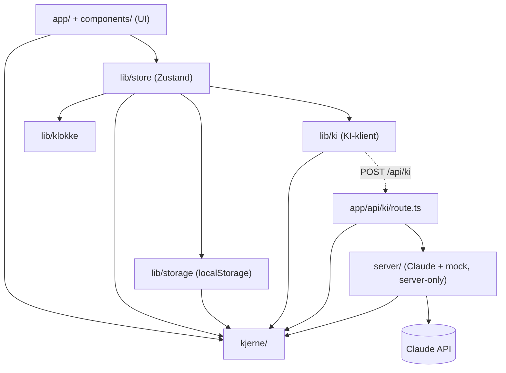
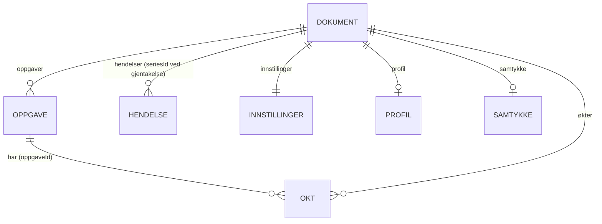
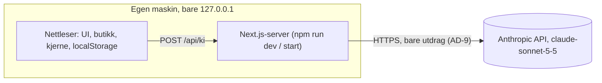

# Arkitektur – dueNext

## Design Paradigm

**Ren domenekjerne med adaptere.** Alle regler fra PRD-en ligger i `kjerne/` som rene TypeScript-funksjoner uten React, nettleser-API-er, nettverk eller klokke. Rundt kjernen ligger tynne adaptere: lagring (localStorage), KI-klient (nettleser → `/api/ki`) og Claude-kallet på serveren. Én Zustand-butikk er eneste vei fra brukerhandling til endret data.

v1 er en lokal demo med fiktive data. All brukerdata ligger i nettleseren. Serveren har bare én oppgave: å sende et begrenset utdrag til Claude og gi tilbake kontrollerte forslag.

| Lag | Mappe | Inneholder |
| --- | --- | --- |
| Kjerne | `kjerne/` | Dokumentskjema, domenetyper, smarte lister, øktregler, Arkiv, reserveløsning, KI-kontrakt og -utløsere, utdrag til KI, migrering, fastsatte tekster |
| Butikk | `lib/store/` | Zustand-butikken med navngitte kommandoer og visningstilstand |
| Adaptere | `lib/storage/`, `lib/ki/`, `lib/klokke.ts` | localStorage-adapter, KI-klient med kallgrense, eneste kilde til «nå» |
| Server | `server/`, `app/api/ki/` | Claude-kallet og mock-KI (`server-only`), route handleren |
| UI | `app/`, `components/` | Sider og komponenter etter DESIGN.md og EXPERIENCE.md |



Pilene viser hvem som får importere hvem. Ingen piler går inn mot UI eller butikken. Kjernen importerer ingenting utenfor `kjerne/`, og adapterne importerer aldri butikken.

## Invariants & Rules

### AD-1 — Kjernen er ren [ADOPTED]

- **Binds:** alle regler i F1–F7, NFR-6, NFR-7
- **Prevents:** at samme regel (liste, øktgrense, sletting) skrives flere steder og gir ulike svar.
- **Rule:** Alle regler fra PRD-en skrives som rene funksjoner i `kjerne/`. Kjernen importerer bare fra `kjerne/` og `zod`. Den bruker ikke React, `window`, `localStorage`, `fetch`, `Date.now()` eller `new Date()` uten argument. Komponenter og butikken kaller kjernen i stedet for å gjenta logikk. Verdier som kan regnes ut (smarte lister, n/N for økter, merkene i FR-52, prosjektlista, «Slettes om N dager»), regnes ut av kjernen og lagres aldri.

### AD-2 — Én butikk, navngitte kommandoer [ADOPTED]

- **Binds:** all endring av data (FR-1–65)
- **Prevents:** flere skrivestier til samme data, og at UI og lagring kommer ut av takt.
- **Rule:** Data endres bare gjennom kommandoer i Zustand-butikken (`lib/store/`), for eksempel `opprettOppgave`, `godtaForslag`, `fullfør`, `slettOppgave`, `mottaKiSvar`. En kommando leser alltid gjeldende tilstand med `get()`, aldri fra en lukning, regner ut ny tilstand med kjernen og setter den. Lagring skjer på ett sted: butikken abonnerer på endringer av dokumentet og ber `lib/storage/` lagre. Komponenter leser fra butikken og kaller kommandoer. De endrer aldri tilstand eller lagring direkte.

### AD-3 — Lagring: ett versjonert dokument i localStorage [ADOPTED]

- **Binds:** NFR-4, FR-40, FR-43, Å-5
- **Prevents:** spredte nøkler, ulike formater, tap av data når formatet endres eller lesingen feiler.
- **Rule:** Alle data lagres som ett JSON-dokument under én localStorage-nøkkel. Bare `lib/storage/` leser og skriver localStorage, med ett unntak: tema-skriptet i AD-16, som bare leser. Lesing og import går samme vei: rå JSON → `kjerne/migrering.ts: migrer(rå)`, som kjører migreringene trinn for trinn ut fra `schemaVersion` og validerer med skjemaet i AD-12 til slutt. Resultatet er et dokument, `for-ny` eller `ugyldig`. Ved `for-ny` eller `ugyldig` overskriver adapteren aldri det lagrede. Appen viser en feilside med eksport av rådata og «Slett alle data». Et migrert dokument skrives tilbake med én gang. Import (FR-43) validerer og migrerer hele fila før noe endres, setter `samtykke` til `null` og starter ingen KI-kall. Klarer ikke nettleseren å lagre, viser appen lagringsvarselet (NFR-4). `lib/storage/` lytter på `storage`-hendelsen og laster dokumentet på nytt når en annen fane har skrevet. Siste skriving vinner. Ingen data sendes til en database eller annen ekstern lagring.

### AD-4 — Datamodell og eierskap [ADOPTED]

- **Binds:** F1, F2, F5, F6, F7
- **Prevents:** to eiere av samme data, for eksempel økter både i en egen liste og inni oppgaven.
- **Rule:** Dokumentet har samlingene `oppgaver`, `økter` og `hendelser`, og objektene `innstillinger`, `profil` og `samtykke` (AD-12, ERD under Structural Seed). Alle samlingene finnes fra `schemaVersion` 1, også om skive 3 ikke er bygget. En økt i `økter` er godtatt eller lagt inn manuelt, og peker til oppgaven med `oppgaveId`. Foreslåtte økter ligger bare i `oppgave.forslag.økter`, aldri i `økter` (FR-50). Når en oppgave slettes, sletter samme kommando øktene. Å fullføre eller gjenåpne en oppgave endrer aldri øktene. Hvor de vises, avledes av `oppgave.fullført`. Prosjekter har ingen egen samling: `oppgave.prosjekt` er eneste kilde, og `slettProsjekt(navn)` setter feltet til `null` på alle oppgaver med navnet (FR-61). En gjentakende hendelse (FR-46) foldes ut til én hendelse per gang av `kjerne/hendelser.ts: foldUt`, med felles `seriesId` og samme `gjentakelse`-regel med påkrevd sluttdato. «Denne og alle senere» deler serien: hendelsene fra valgt dato får ny `seriesId`, og de tidligere får sluttdato dagen før. ID-er lages med `crypto.randomUUID()`.

### AD-5 — Tid og dato [ADOPTED]

- **Binds:** F4, F5, FR-12, FR-45, FR-49, NFR-7
- **Prevents:** at én del regner i UTC og en annen i lokal tid, ulike kilder til «nå», eller at tester ikke kan styre tiden.
- **Rule:** Planlagte ting lagres uten tidssone: datoer som `"YYYY-MM-DD"` og klokkeslett som `"HH:mm"`, tolket i lokal tid (Europe/Oslo). Uka går fra mandag til søndag. Tidspunkter for hendelser i appen (`createdAt`, `fullført`, `avhuket`, samtykke) lagres som `new Date().toISOString()` (UTC). Kjernefunksjoner som avhenger av tid, tar «nå» som parameter. Butikken har `nå` i tilstanden. Den lagres ikke. Den settes ved oppstart og oppdateres av én takt i `lib/klokke.ts` hvert minutt og når fanen blir synlig igjen. Alle selektorer og komponenter bruker `state.nå`. Ingen andre leser klokka. Takten kjører kommandoen `vedlikehold(nå)` ved oppstart og hver time. Den kjører `ryddArkiv` og forkaster passerte øktforslag (FR-12). «7 dager» i FR-30 betyr 7 × 24 timer fra `fullført`, og «Slettes om N dager» regnes av samme kjernefunksjon. Playwright styrer tiden bare med `page.clock`.

### AD-6 — Én serverrute til Claude [ADOPTED]

- **Binds:** F2, NFR-2, NFR-3, NFR-12
- **Prevents:** flere veier til Claude, at nøkkelen havner i nettleseren, eller at forespørsel og svar får ulike former.
- **Rule:** Nettleseren snakker med Claude bare gjennom `POST /api/ki` (route handler i `app/api/ki/route.ts`). Det brukes ingen Server Actions for KI. Claude-kallet ligger i `server/claude.ts`, som har `import 'server-only'` og leser `ANTHROPIC_API_KEY`. Forespørsel og svar har zod-skjema i `kjerne/ki-kontrakt.ts`:
  - forespørsel: `{ type: "forslag", ønsker: { felt, økter }, utdrag }` eller `{ type: "nyTid", øktId, utdrag }`
  - svar: `{ type: "ok", felt, økter, forkastet }` eller `{ type: "reserve", årsak }`, der `årsak` er `"ingen-nokkel" | "tidsavbrudd" | "tomt" | "ugyldig" | "avvist" | "api-feil" | "kallgrense"`.

  Felt som er ugyldige, står i `forkastet` og får reserveløsningen hver for seg (FR-14). Serveren logger aldri innholdet i forespørsler eller svar (NFR-3).

### AD-7 — Claude-kallet [ADOPTED]

- **Binds:** FR-8, FR-14, FR-49, FR-53, NFR-12, Å-1
- **Prevents:** at kallet henger, går over tidsgrensen, svarer fra en annen modell eller gir svar som ikke passer skjemaet.
- **Rule:** Modell `claude-sonnet-5-5` via `@anthropic-ai/sdk` 1.x, med `client.messages.parse` og `zodOutputFormat` fra `@anthropic-ai/sdk/helpers/zod`, med skjemaet fra `kjerne/ki-kontrakt.ts`. Kallet bruker `output_config: { effort: "low" }`, `maxRetries: 0` og ingen fallback til andre modeller. Fristen på 15 s (NFR-12) gjelder hele kallet sett fra nettleseren og eies av `lib/ki/` (`AbortSignal.timeout(15000)`). Serveren har en total frist på 13 000 ms og avbryter Claude-kallet når forespørselen fra nettleseren lukkes (`request.signal`). Systemprompten er på norsk og ligger fast i `server/`. Kjernen kontrollerer svaret (FR-14 og grensene i FR-49) før det returneres. Øktforslag som bryter grensene, forkastes ett og ett. `stop_reason: "refusal"` gir `avvist`, og API-feil gir `api-feil`.

### AD-8 — Reserveløsning og kallgrense i nettleseren [ADOPTED]

- **Binds:** F3, FR-16–19, FR-53, FR-62, NFR-1, NFR-12
- **Prevents:** at appen slutter å virke uten nøkkel eller server, at reserveløsningen gir forslag PRD-en ikke vil ha, og at grensen telles ulikt to steder.
- **Rule:** `lib/ki/` er eneste sted som kaller `/api/ki`. Den endrer aldri tilstand og importerer ikke butikken. Den returnerer et `Promise` med resultatet til kommandoen som startet kallet. Kallgrensen ligger i minnet i `lib/ki/kallgrense.ts`: et glidende vindu på 60 s med høyst 10 kall. Alle kall teller, også `nyTid`. Grensen lagres ikke og gjelder per fane. Når grensen er nådd, returneres `{ type: "reserve", årsak: "kallgrense" }` uten nettverkskall. Hva en `reserve` gir, avgjøres av én tabell i `kjerne/reserve.ts` (kalltype × årsak):
  - Ved feltforslag gir reserveløsningen etikett og prioritet, bare for felt kallet ba om eller som står i `forkastet` (FR-16–18).
  - Ved kall som bare gjelder øktforslag, gir den ingen forslag (FR-17, FR-62).
  - Ved `nyTid` gir den aldri forslag. UI viser teksten fra FR-53.

### AD-9 — Utdrag til KI [ADOPTED]

- **Binds:** FR-15, FR-38, FR-39, FR-58, FR-59, Å-8
- **Prevents:** at ulike kall sender ulike data, eller mer enn PRD-en tillater.
- **Rule:** Det som sendes, lages av én ren funksjon i `kjerne/` som får oppgaven, hendelsene, øktene, innstillingene og «nå». Hendelser og andre godtatte økter tas med for perioden fra i dag og 14 dager fram, men aldri etter fristdagen. Bare tidspunkter sendes, pluss hendelsestitler når FR-58 er på og hendelsen ikke har 🔒. Fornavn sendes aldri. Ingenting fra en oppgave med 🔒 sendes. Notater sendes ikke når FR-39 er på. Hendelser og økter tas bare med når forespørselen ønsker økter, eller når den gjelder `nyTid`.

### AD-10 — Klientside-rendering av data [ADOPTED]

- **Binds:** alle sider med brukerdata
- **Prevents:** hydreringsfeil fordi serveren ikke ser localStorage.
- **Rule:** Sider og komponenter som viser brukerdata, er klientkomponenter (`'use client'`). De viser et skjelett til butikken har lest fra lagringsadapteren. Lagring startes først etter at innlastingen er ferdig, slik at et tomt dokument aldri overskriver lagrede data. Serverkomponenter brukes bare til faste rammer uten brukerdata. Data hentes ikke fra serveren, bortsett fra `/api/ki`.

### AD-11 — Bare lokal kjøring [ADOPTED]

- **Binds:** NFR-1, NFR-11, NFR-12
- **Prevents:** at andre på samme nettverk eller internett kan bruke gruppens nøkkel, eller at appen publiseres før personvern og grenser er vurdert.
- **Rule:** Skriptene i `package.json` starter Next med `-H 127.0.0.1` (`dev` og `start`), slik at serveren bare kan nås fra egen maskin. `/api/ki` avviser forespørsler der `Host` ikke er `127.0.0.1` eller `localhost`. v1 kjøres med `npm run dev` eller `npm run build && npm start` og publiseres ikke. Uten `ANTHROPIC_API_KEY` i `.env.local` virker alt unntatt KI. Skal appen publiseres eller brukes med ekte data, må NFR-11 og servergrensen i NFR-12 være på plass først, og denne AD-en må endres.

### AD-12 — Dokumentskjemaet er låst i kjernen [ADOPTED]

- **Binds:** F1, F2, F5, F6, F7, FR-35, FR-43, FR-50
- **Prevents:** at moduler legger til egne felt, eller at samme sak lagres med ulike navn og former.
- **Rule:** Alle typer i lagringsdokumentet er zod-skjemaer i `kjerne/skjema.ts`, og TypeScript-typene avledes med `z.infer`. Ingen modul legger til felt utenfor skjemaet. Et nytt felt krever endring i skjemaet, en økning av `GJELDENDE_SKJEMAVERSJON` og en migrering med test (AD-3). Disse formene er bindende:
  - `oppgave.forslag`: `{ felt: { etikett?, prioritet?, sammendrag? }, økter: ØktForslag[] } | null`. Hvert felt er `{ verdi, kilde: "ki" | "regelbasert" }`, og hvert øktforslag er `{ id, dato, start, slutt }`. «Godta» og «Endre» fjerner forslaget. Når begge delene er tomme, er `forslag` `null`.
  - `oppgave.fullført` og `økt.avhuket`: ISO-tidsstempel eller `null`. Det finnes ingen `status`-felt.
  - `økt.kilde`: `"ki" | "manuell"`.
  - `oppgave.ventendeKall`: `{ id, type } | null` (AD-13).
  - `samtykke`: `{ svar: "ja" | "nei", tidspunkt, tekstversjon: number } | null`. `kjerne/samtykke.ts` har `GJELDENDE_SAMTYKKEVERSJON` og `kiErPå(dokument)`, som er sann bare når svaret er ja og versjonen er gjeldende. `kiErPå` og `kanSendes(oppgave, dokument)`, som også sjekker 🔒, er de eneste stedene som avgjør om KI brukes. Butikken, `lib/ki/` og UI (FR-37, FR-54) kaller dem.
  - JSON-nøkler bruker de samme norske navnene med æøå som koden (`økter`, `ønsker`).

### AD-13 — KI-kallets livsløp [ADOPTED]

- **Binds:** FR-8, FR-12, FR-13, FR-19, FR-38, FR-43, FR-53, FR-62
- **Prevents:** at et sent svar skriver over nyere data, at en slettet oppgave dukker opp igjen, eller at forslag vises etter 🔒 eller tilbaketrukket samtykke.
- **Rule:** KI-kall startes bare av kommandoer, etter reglene i `kjerne/ki-trigger.ts`. Den samler FR-8, FR-13 og FR-62 i én tabell som avgjør `ønsker` for et kall. Kall startes aldri ved oppstart, import eller visning. Én lagring gir høyst ett `forslag`-kall. Skive 3 utvider `ønsker.økter` og legger ikke til egne kall. Kommandoen lager en `id` med `crypto.randomUUID()` og lagrer den i `oppgave.ventendeKall`. Når svaret kommer, kaller butikken `mottaKiSvar(oppgaveId, id, resultat)`. Den forkaster svaret uten melding hvis oppgaven er borte, hvis `ventendeKall.id` ikke stemmer, hvis `kanSendes` er usann eller hvis fristen er endret siden kallet startet (gjelder øktforslag). Et nytt kall på samme oppgave erstatter `ventendeKall`. `ventendeKall` settes til `null` ved oppstart og import. Et kall som ble borte ved omlasting, gir ingen forslag.

### AD-14 — Mock-KI bor på serveren [ADOPTED]

- **Binds:** NFR-5, NFR-6
- **Prevents:** at testene hopper over ruta og kontrollen av svaret, eller at mocken bygges to steder med ulike formater.
- **Rule:** Mock-KI finnes bare i `server/` og erstatter selve Claude-kallet. Ruta og alle kontroller kjører som vanlig. Når `KI_MOCK=1`, velger serveren et fast svar fra `tests/ki-testsett/mock/` ut fra headeren `x-ki-mock`: `gyldig`, `ugyldig`, `tomt`, `tidsavbrudd` eller `treg-10s`. Uten header brukes `gyldig`, og uten `KI_MOCK` ignoreres headeren. `tidsavbrudd` gir samme resultat som et ekte tidsavbrudd, uten å vente. Klienten har ingen mock-kode og ingen `NEXT_PUBLIC_`-variabler for KI. Playwright setter headeren.

### AD-15 — Navigasjon og responsivt oppsett [ADOPTED]

- **Binds:** NFR-10, EXPERIENCE.md (Information Architecture, Responsive & Platform)
- **Prevents:** at detalj, skjema og panel bygges med ulike rutemodeller på mobil og PC.
- **Rule:** Faste sider er egne ruter: `/` (Oppgaver), `/kalender`, `/arkiv`, `/innstillinger`, `/personvern`, `/personvernerklaering` og `/oppstart` (førstegangsoppsett). Valgt innhold står i søkeparametre på samme side: `?oppgave=<id>`, `?hendelse=<id>`, `?ny=oppgave|hendelse` og `/kalender?dag=YYYY-MM-DD`. Samme adresse gir egen side med tilbakepil under Tailwinds `lg` (1024 px), og detaljpanel til høyre fra `lg`. Det brukes ingen parallel eller intercepting routes. Rotlayouten sender til `/oppstart` når KI-valget ikke er besvart (`samtykke` er `null`), for eksempel ved første oppstart, etter «Slett alle data» og etter import.

### AD-16 — Tema og språk i rotlayouten [ADOPTED]

- **Binds:** FR-60, FR-63, NFR-8, NFR-9
- **Prevents:** at siden blinker i feil tema, gir hydreringsfeil, eller at tema settes på ulike måter.
- **Rule:** `app/layout.tsx` har `<html lang="nb" suppressHydrationWarning>`. Et lite skript i `<head>`, eid av `lib/storage/`, leser bare tema og modus fra lagringsdokumentet og setter `data-tema` og `data-modus` på `<html>` før første tegning. Det er eneste unntak fra AD-3. Etter det er det butikken som endrer attributtene. Fargene fra DESIGN.md er CSS-variabler i `app/globals.css`, styrt av disse to attributtene.

### AD-17 — Visningstilstand lagres ikke [ADOPTED]

- **Binds:** FR-25, FR-26, FR-27
- **Prevents:** at Oppgaver og Kalender har hvert sitt filter, eller at sorteringen huskes i strid med FR-25.
- **Rule:** Filter og søk ligger i butikken i en egen del, `visning`, som ikke lagres og deles av Oppgaver og Kalender. Sortering er lokal tilstand i lista og starter på «Frist» hver gang lista vises. Ingenting i `visning` skrives til lagringsdokumentet.

## Consistency Conventions

| Concern | Convention |
| --- | --- |
| Navn på domenet | Norske ord fra PRD-en med æøå i kode og JSON-nøkler: `Oppgave`, `Økt`, `Hendelse`, `frist`, `prosjekt`, `fullfør()`, `godtaForslag()`, `ryddArkiv()` |
| Tekniske navn | Engelsk: `store`, `adapter`, `schema`, `hook`, `id`, `createdAt`, `seriesId`, `schemaVersion`, `useStore` |
| Filnavn | Uten æøå, kebab-case: `okter.ts`, `smarte-lister.ts`, `ki-kontrakt.ts` |
| Tekst i appen | Norsk. Fastsatte tekster fra EXPERIENCE.md ligger ordrett i `kjerne/tekster.ts`, sammen med samtykkeversjonen. Komponenter skriver dem ikke selv |
| Tilgjengelighet | WCAG 2.1 AA (NFR-9, EXPERIENCE.md → Accessibility Floor). Playwright-testene kjører en automatisk tilgjengelighetssjekk med `@axe-core/playwright` på hver hovedside |
| ID-er | `crypto.randomUUID()` |
| Datoer og tid | AD-5 |
| Validering | zod-skjemaer i `kjerne/` for lagring, import og KI-kontrakten (AD-6, AD-12) |
| Feil | Kjernefunksjoner returnerer et resultat eller en navngitt feiltype og kaster ikke for forventede feil. Feil vises med tekstene i `kjerne/tekster.ts` |
| Konfig | `ANTHROPIC_API_KEY` (hemmelig) og `KI_MOCK` (bare test), begge i `.env.example`. Ingen `NEXT_PUBLIC_`-variabler for KI |
| Tester | Vitest for `kjerne/` med fast «nå», og én test per migrering. Playwright for Flyt 1–7 med mock-KI (AD-14) og `page.clock` (AD-5) |
| Leveranseskiver | Skive 1 og 2 bygges uten å endre AD-ene. Skive 3 legger til kommandoer, kjernefunksjoner og UI, men ikke nye samlinger, kall eller rutemodeller |

## Stack

| Name | Version |
| --- | --- |
| Node.js | 26.7.0 (lokalt, `engines` ≥ 22) |
| Next.js (App Router, Turbopack) | 16.3.5 |
| React | 19.2.8 |
| TypeScript | 5.x |
| Tailwind CSS | 4.x |
| Zustand | 5.1.0 |
| zod | 4.6.7 |
| @anthropic-ai/sdk | 1.14.0 |
| server-only | 0.0.1 |
| Claude-modell | claude-sonnet-5-5 |
| Vitest (med vite) | 5.1.2 |
| @playwright/test | 1.65.1 |
| @axe-core/playwright | 4.14.1 |
| @types/node | ^24 |

Endringer i `package.json`:
- **legges til:** `zustand`, `zod`, `server-only`, `vitest`, `vite`, `@playwright/test` og `@axe-core/playwright`
- **oppgraderes:** `@anthropic-ai/sdk` fra 0.126 til 1.14, og `@types/node` fra ^20 til ^24
- **fjernes:** `prisma` og `@prisma/client`

v1 blir på disse versjonene, selv om nyere versjoner av Next, React og TypeScript finnes. Startfilene fra create-next-app (`app/page.tsx`, bildene i `public/`) erstattes i første story.

## Structural Seed

```text
app/
  layout.tsx              # html lang="nb", tema-skript, personvernlenke (AD-16)
  page.tsx                # Oppgaver, med ?oppgave= og ?ny= (AD-15)
  kalender/ arkiv/ innstillinger/ personvern/ personvernerklaering/ oppstart/
  api/ki/route.ts         # eneste serverrute (AD-6, AD-11)
components/               # UI-komponenter fra DESIGN.md
kjerne/                   # skjema, regler, ki-kontrakt, ki-trigger, reserve, migrering, tekster (AD-1, AD-12)
lib/
  store/                  # Zustand-butikken (AD-2, AD-17)
  storage/                # localStorage-adapter og tema-skript (AD-3, AD-16)
  ki/                     # KI-klient og kallgrense (AD-8, AD-13)
  klokke.ts               # eneste kilde til «nå» (AD-5)
server/
  claude.ts               # Claude-kallet (AD-7)
  mock.ts                 # mock-KI (AD-14)
tests/
  kjerne/                 # Vitest
  e2e/                    # Playwright
  ki-testsett/            # testsett og mock-svar
```





## Capability → Architecture Map

| Capability / Area | Skive | Lives in | Governed by |
| --- | --- | --- | --- |
| F1 Oppgaver | 1 | `kjerne/`, `lib/store/`, `app/` | AD-2, AD-4, AD-12 |
| F1 Hendelser (FR-44–48, FR-64) | 3 | `kjerne/hendelser.ts`, `lib/store/`, `app/` | AD-4, AD-5, AD-15 |
| F2 Forslag til felt | 2 | `lib/ki/`, `app/api/ki/`, `server/`, `kjerne/` | AD-6, AD-7, AD-9, AD-13 |
| F2 Økter (FR-49–54) | 3 | samme som over | AD-4, AD-6, AD-9, AD-13 |
| F3 Reserveløsning | 1 | `kjerne/reserve.ts`, `lib/ki/` | AD-8 |
| F4 Smarte lister, filter, søk | 1 | `kjerne/`, `app/` | AD-1, AD-5, AD-17 |
| F4 Kalender (FR-55) | 3 | `kjerne/`, `app/kalender/` | AD-1, AD-15, AD-17 |
| F5 Arkiv og sletting | 1 | `kjerne/`, `lib/store/` | AD-4, AD-5 |
| F6 Personvern og egne data | 2 | `kjerne/samtykke.ts`, `kjerne/tekster.ts`, `lib/storage/`, `app/personvern/`, `app/oppstart/` | AD-3, AD-9, AD-11, AD-12 |
| F7 Profil, utseende, prosjekter | 1 | `lib/store/`, `app/innstillinger/`, `app/globals.css` | AD-4, AD-16 |
| NFR-6/7 Testbarhet | alle | `tests/`, `lib/klokke.ts`, `server/mock.ts` | AD-1, AD-5, AD-14 |
| NFR-12 Grenser for KI-kall | 2 | `lib/ki/`, `server/claude.ts` | AD-7, AD-8 |

## Deferred

- **Nøkkelord for reserveløsningen (Å-7).** Bestemmes i storyen for F3 og testes mot KI-testsettet. Reglene ligger uansett i `kjerne/reserve.ts` (AD-8).
- **Komponentbibliotek.** Om dere bruker shadcn/ui eller lager egne komponenter, avgjøres i første UI-story. DESIGN.md og AD-16 gjelder uansett.
- **Prompt-teksten til Claude.** Skrives og justeres mot KI-testsettet i storyen for F2. Formen er låst av `kjerne/ki-kontrakt.ts` (AD-6, AD-7). Storyen bør bekrefte med ett ekte kall at `effort` virker som forventet med `claude-sonnet-5-5`.
- **Ytelse ved store datamengder.** Ikke aktuelt for en demo. Blir localStorage for lite, byttes bare `lib/storage/` (AD-3).
- **Publisering, innlogging og ekstern lagring (v2).** Krever ny personvernvurdering (NFR-11), servergrense og kostnadstak (NFR-12), en kallgrense som deles mellom faner, og nye versjoner av AD-3, AD-8 og AD-11. Mønstrene i `technology.md` (mock-fallback, feature flags, Supabase) kan være utgangspunkt.
- **CI og drift.** Ingen pipeline eller overvåking i v1. Tester kjøres lokalt.
