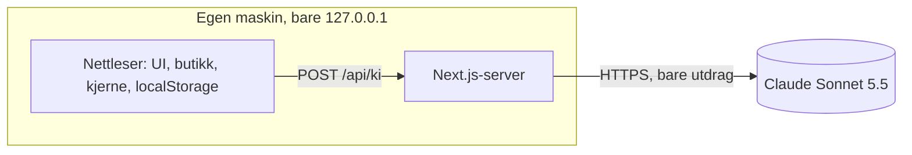
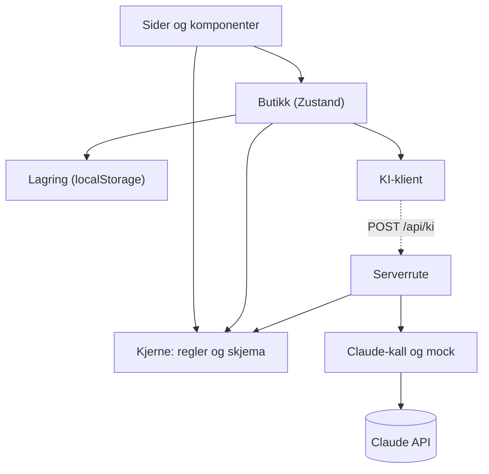

# dueNext-arkitekturen

IBE160 · Gruppe G43 · 26.11.2026

Denne siden er en lesbar oversikt over hvordan dueNext v1 er bygget opp, hvilke valg vi tok, og hvorfor. Den bygger på [arkitekturdokumentet](ARCHITECTURE-SPINE.md), som er byggegrunnlaget for KI-agentene som skriver koden. Begrunnelsene er hentet fra arbeidsloggen [.memlog.md](.memlog.md). Grunnlaget er [PRD-en](../../prds/prd-G43-grafstrom-haugen-sivakumar-2026-11-02/prd.md), [DESIGN.md](../../ux-designs/ux-G43-grafstrom-haugen-sivakumar-2026-11-09/DESIGN.md) og [EXPERIENCE.md](../../ux-designs/ux-G43-grafstrom-haugen-sivakumar-2026-11-09/EXPERIENCE.md).

## Kort fortalt

- **Alt kjører på egen maskin.** v1 er en lokal demo med fiktive data. Serveren lytter bare på 127.0.0.1.
- **Data ligger i nettleseren.** Alt lagres som ett versjonert JSON-dokument i localStorage. Det er ingen database og ingen innlogging.
- **Reglene er samlet ett sted.** Smarte lister, øktgrenser og Arkiv er rene funksjoner i `kjerne/`, testet med fast tid.
- **Én vei til Claude.** Én serverrute sender et begrenset utdrag til Claude Sonnet 5.5. Feiler kallet, tar reserveløsningen over.

## Systemet

Nettleseren gjør nesten alt: viser sidene, holder dataene og regner ut listene. Serveren finnes bare fordi API-nøkkelen ikke kan ligge i nettleseren.

### Lagene i koden

Pilene viser hvem som får bruke hvem. Kjernen bruker ingen andre lag, så den kan testes alene. Komponentene endrer aldri data selv. De ber butikken om det.

## De viktigste valgene

For hvert valg viser tabellen hva vi landet på, hva vi vurderte i stedet, og hvorfor. AD-nummeret viser til beslutningen i arkitekturdokumentet.

| Valg | Alternativ vi vurderte | Hvorfor | AD |
| --- | --- | --- | --- |
| Ren kjerne med adaptere | Logikk i komponenter og hooks | Reglene i PRD-en er mange og presise. Når de er samlet i rene funksjoner, kan de testes med fast «nå» og mock-KI (NFR-6, NFR-7), og KI-agentene kan ikke lage hver sin versjon. | AD-1 |
| localStorage, ett dokument | IndexedDB | Datamengden er liten. Ett versjonert dokument med migrering er enklere og holder for en demo. Blir det for lite, må bare lagringsadapteren byttes. | AD-3 |
| Ingen database, Prisma fjernes | Supabase eller Postgres | v1 bruker bare fiktive data og skal ikke lagre noe hos gruppen. Database og innlogging krever ny personvernvurdering (NFR-11). | AD-3, AD-11 |
| Zustand-butikk med kommandoer | Reacts `useSyncExternalStore` | Zustand er kjent og lite. Kommandoene gir én vei inn for alle endringer. | AD-2 |
| Én route handler, `POST /api/ki` | Server Actions | Den gir én synlig kontrakt som er lett å mocke og å avbryte. Server Actions er også offentlige endepunkter, men mindre synlige i koden. | AD-6 |
| Claude Sonnet 5.5, SDK 1.x | SDK 0.126, fallback til andre modeller | Strukturert svar med zod og lav effort passer en kort klassifisering. Fallback krever beta-API-et og kan gi en annen modell, så en avvisning gir reserveløsningen i stedet. | AD-7 |
| Reserveløsning i nettleseren | Reserveløsning på serveren | Den virker også når serveren eller nøkkelen mangler, slik at sensor kan kjøre appen uten nøkkel (NFR-1). | AD-8 |
| 14 dager med hendelser til KI | Hele perioden fram til fristen | 14 dager dekker en typisk innlevering og holder utdraget lite. Det sendes aldri noe etter fristdagen. | AD-9 |
| Dato og klokkeslett som tekst | Tidsstempler med tidssone | Nattevakter, uker fra mandag og «passert når dagen er over» blir enkle og like overalt. | AD-5 |
| Navigasjon med søkeparametre | Egne ruter med intercepting routes | Samme adresse gir egen side på mobil og panel på PC. Det er enklere og vanskeligere å gjøre feil i. | AD-15 |

## Personvern i arkitekturen

Personvernkravene i PRD-en er bygget inn i strukturen, ikke bare i tekstene.

- Ingen data lagres utenfor nettleseren. Derfor sletter «Slett alle data» alt (AD-3).
- Det som sendes til Claude, lages av én funksjon som følger FR-15. Fornavnet sendes aldri, ingenting sendes fra oppgaver med 🔒, og hendelsestitler sendes bare når studenten tillater det (AD-9).
- Én funksjon, `kiErPå`, avgjør om KI brukes. Den krever at studenten har sagt ja til gjeldende versjon av samtykketeksten (AD-12).
- Serveren lytter bare på egen maskin og logger ikke innhold (AD-6, AD-11).

## Kvalitetssikring

Tre uavhengige gjennomganger sjekket utkastet før det ble ferdig. Alle funnene er rettet eller lagt under «Utsatt med vilje». Rapportene ligger i [reviews/](reviews/).

| Gjennomgang | Funn | Hva det førte til |
| --- | --- | --- |
| Versjoner og teknologi | 1 høyt, 2 middels, 1 lavt | Fallback ble fjernet fordi den krever beta-API-et. Pakkelista i `package.json` ble gjort fullstendig. |
| Motstanderlesning | 2 kritiske, 6 høye, 8 andre | Den viste hvordan to deler kunne følge alle reglene og likevel bli bygget ulikt. Det førte til AD-12, AD-13, AD-14 og AD-17. |
| Sjekkliste og kilder | 4 høye, 7 middels, 5 lave | Serveren lyttet på hele nettverket, og navigasjon og tema manglet. Det førte til AD-11, AD-15 og AD-16. |

## Leveranseskiver

PRD-en deler v1 i tre skiver. Arkitekturen er laget slik at skive 3 kan kuttes uten at noe annet må endres. Alle samlingene finnes i lagringsformatet fra start, og øktforslag utvider det samme KI-kallet i stedet for å legge til et nytt.

| Skive | Innhold | Viktigste AD-er |
| --- | --- | --- |
| 1 Oppgaveapp | Oppgaver, reserveløsning, smarte lister, filter, søk, Arkiv og utseende | AD-1–5, AD-8, AD-16, AD-17 |
| 2 KI og personvern | KI-forslag til felt, samtykke og personvernkontroller | AD-6, AD-7, AD-9, AD-12, AD-13 |
| 3 Planlegging | Hendelser, økter og Kalender | AD-4, AD-9, AD-13, AD-15 |

## Utsatt med vilje

- **Nøkkelord for reserveløsningen.** Velges i storyen for F3 og testes mot KI-testsettet.
- **Prompt-teksten til Claude.** Skrives mot KI-testsettet. Formen på svaret er allerede låst.
- **Komponentbibliotek.** Avgjøres i første UI-story.
- **Publisering, innlogging og ekstern lagring.** Hører til v2 og krever ny personvernvurdering først.

## Alle beslutningene

| AD | Beslutning |
| --- | --- |
| AD-1 | Ren kjerne |
| AD-2 | Én butikk med navngitte kommandoer |
| AD-3 | Lagring i ett versjonert dokument |
| AD-4 | Datamodell og eierskap |
| AD-5 | Tid og dato |
| AD-6 | Én serverrute til Claude |
| AD-7 | Claude-kallet |
| AD-8 | Reserveløsning og kallgrense |
| AD-9 | Utdrag til KI |
| AD-10 | Klientside-rendering |
| AD-11 | Bare lokal kjøring |
| AD-12 | Dokumentskjemaet er låst |
| AD-13 | KI-kallets livsløp |
| AD-14 | Mock-KI på serveren |
| AD-15 | Navigasjon og responsivt oppsett |
| AD-16 | Tema og språk |
| AD-17 | Visningstilstand lagres ikke |

---

Laget med BMad-skillen `bmad-architecture` i coaching-modus. Gruppen tok de store valgene, mens KI-assistenten la fram alternativer og skrev dokumentet. Samme innhold finnes som en HTML-side på claude.ai: https://claude.ai/artifact/D9GSk4vhdT4AfE4gFJwGQz. Den er privat til den deles.
